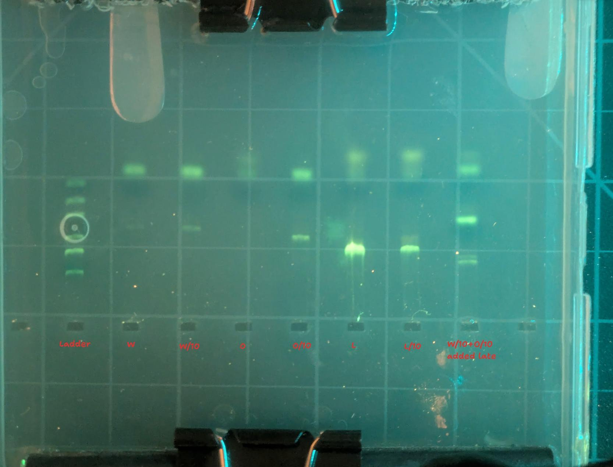
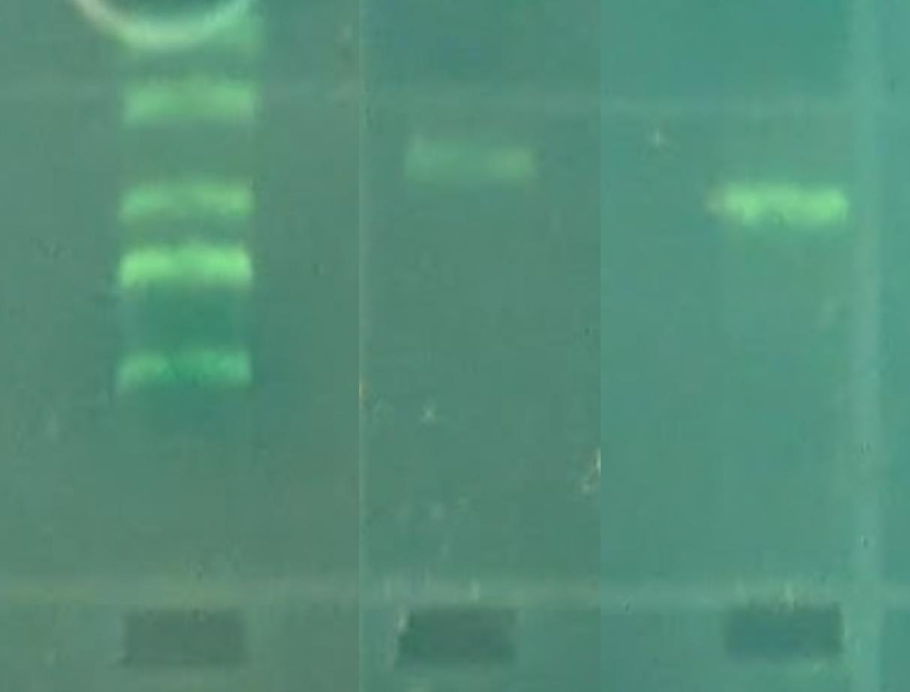



In early June I noticed some white flowers in amidst the prolific and gorgeous orange California poppies in the flower beds along one of our regular walk routes. Intrigued, I took some samples and preserved some tissue from each in Zymo DNA shield, thinking I'd later look into options to sequence them or otherwise probe for the mutation that caused the loss of pigment. A bit of research turned up some existing literature on this - these white variants aren't uncommon in horticulture, and scientists had already nailed down a 76 base-pair deletion in the DNA that they found is usually present in the white ones. This month I finally got access to a thermocycler, and decided to use PCR to see if my samples had the same change present.

PCR is a technique for amplifying select DNA. You order some 'primers' - short snippets of DNA that mark the start and end of the sequence you wish to amplify. Then, with a clever mix of enzymes and tempterature control, you make many, MANY copies of any DNA that matches those templates. Finally, you typically put some of the resulting mix into a well in an agarose gel and apply an electric field, spreading out the DNA (if present) into bands sorted by length (since larger strands travel more slowly through the thick gel). I did one practice run that failed to show bands in most lanes, then a more careful repeat that delivered the goods:

Here's the protocol I followed, using reagents from the [MiniPCR fungal barcoding kit](https://www.minipcr.com/product/fungal-dna-barcoding/):

- A small piece of tissue (<2mm in size) was taken out of the zymo, washed with distilled water, and then placed into 50ul of the 'DPX' extraction mix.
- 2ul of that extract was added to 12.5ul 2X master mix and 8.5uL water in a PCR tube, with 2uL primer mix.
- (primers: diluted to 100nmol/mL then 10ul F and 10ul R + 180uL water)
- 2ul of that mix was added to a second tube, with the same extras (master mix, water, primers) - this dilution is sometimes helpful if there are too many PCR inhibitors in the full-strength sample. PCR can work with tiiiiny amounts of DNA, so erring towards extreme dilution is not a bad idea!
- These 25ul volumes were then run through the following temperature profile: 94C 30s, 52C 40s, 72C 60S x 40, 72C 5min, 4C

Finally, 5ul of each PCR product was added to 1ul of 6X loading dye and run in a 2% agarose gel with SeeGreen stain (made from [these](https://www.minipcr.com/product-category/reagents/gel-electrophoresis-reagents/all-in-one-agarose-tabs/) nifty all-in-one tabs) with my DIY electrophoresis rig.

Comparing the lengths travelled by the two bands and the DNA ladder, we can see that the orange looks to be around 500 b.p. and the white one looks about right for 425-ish:

I also used some moth barcoding primers to amplify a bit of DNA from a moth sample I wanted to ID in this run, so the temp profile was a bit of a compromise between the two protocols suggested in the literature. It worked great :)

Here are the primers used:

Poppies:

PSY-Gap-F TCAAGCAACGACGGAGAGTA
PSY-Gap-R CCTTGCCTGCGAATATGTCT

Moth:

LepF1 ATTCAACCAATCATAAAGATATTGG
LepR1 TAAACTTCTGGATGTCCAAAAAATCA

Soooo nice to have this capability. I have since aquired my own Bento Lab Pro so I have a thermocycler to call my own - and I'm hoping to run some workshops for the Portland DIYBio community soon.